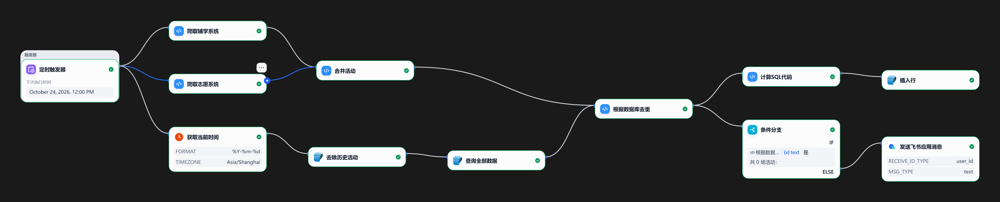

# 南开活动报名自动搜集（CAS 登录 + Dify 工作流）

用 **CAS 统一身份认证登录** 南开校内两个活动平台，抓取「未来可报名」的活动，**合并 → 按数据库去重 → 写入 SQLite → 推送飞书**，全程由 **Dify 工作流** 定时驱动。

- 数据源：志愿系统 `zyfw.nankai.edu.cn`、辅学平台 `fuxue.nankai.edu.cn`
- 运行宿主：Dify「代码执行」节点（Python 3，纯文本单字符串输出）
- 存储：SQLite（`D:\sqlite\dify_sqlite\activities.db`，容器内挂载为 `/dify_sqlite`）
- 通知：飞书应用消息
- 调度：Dify「定时触发器」



> 上面是 Dify 画布导出图，下文「工作流拆解」与它一一对应（图里的「下次执行时间 12:00 PM」只是导出那一刻的值，实际触发按画布设定的间隔）。

---

## 目录

1. [项目概览](#1-项目概览)
2. [仓库结构](#2-仓库结构)
3. [工作流拆解（Dify 节点逐个说明）](#3-工作流拆解dify-节点逐个说明)
4. [爬虫内核](#4-爬虫内核)
5. [数据库](#5-数据库)
6. [本地运行与调试](#6-本地运行与调试)
7. [常用命令与 SQL](#7-常用命令与-sql)
8. [踩坑清单（Dify 硬约束）](#8-踩坑清单dify-硬约束)
9. [安全与合规](#9-安全与合规)
10. [参考文档](#10-参考文档)

---

## 1. 项目概览

### 1.1 解决什么问题

南开的活动分散在两个互不相通的系统里，且报名名额先到先得。本项目把两站的活动汇总成统一格式，由 Dify 定时触发器按设定的间隔（如每小时）自动跑一轮：

1. 先登录两个系统（南开统一身份认证 CAS / IAM），密码按前端算法 **AES-256-CBC 加密**后提交，不落明文；
2. 抓取列表页 → 逐条请求详情页 → 解析出活动字段 → 过滤掉已开始/已结束的活动；
3. 两个平台的结果合并成**一段固定格式的纯文本**；
4. 与 SQLite 里「已经通知过」的活动按名称比对，去掉重复项；
5. 剩下新活动入库，并通过飞书应用消息推送到个人/群。

### 1.2 设计原则

| 原则 | 做法 |
|---|---|
| 无新增依赖 | 爬虫内核只依赖标准库 + `requests`（Dify 沙箱自带）；本地脚本另用 `lxml`、可选 `pycryptodome` |
| 凭据不进源码 | 账号密码来自环境变量 `CAS_USERNAME` / `CAS_PASSWORD`（Dify 里配置成加密环境变量） |
| 节点间只传字符串 | 除「计算SQL代码」外，所有代码节点输出变量只有 `text`（String），避免 Dify 变量校验报错 |
| 幂等 | 入库用 `INSERT OR IGNORE` + 表级 `UNIQUE(来源系统, 活动名称, 活动时间)`，重复运行不产生脏数据 |
| 失败不阻断 | 爬虫节点 `RAISE_ERRORS=False`，抓取失败返回 `抓取失败：...` 文本；当批为 0 条时工作流走「条件分支」不推送 |

### 1.3 处理链路速览

```
定时触发器
  ├─ 获取当前时间(%Y-%m-%d, Asia/Shanghai) → 去除历史活动(SQLite DELETE) → 查询全部数据(SQLite SELECT)
  └─ 爬取辅学系统(代码) ┐
     爬取志愿系统(代码) ┴→ 合并活动(代码) → 根据数据库去重(代码) ─┬→ 计算SQL代码(代码) → 插入行(SQLite INSERT)
                                                              └→ 条件分支 → 发送飞书应用消息
```

---

## 2. 仓库结构

```
internet-robot-with-CAS-login-on-NKU/
├── 志愿系统爬虫/
│   ├── cas_login.py          # 本地独立脚本：CAS 登录 + 志愿系统抓取，结果打印到 stdout（263 行）
│   └── cas_core.py           # Dify 代码节点版内核：main(**kwargs) -> {"text": ...}（624 行）
├── 辅学系统爬虫/
│   ├── cas_login.py          # 辅学平台全链路独立脚本：登录→SSO 中转→爬取，可导出 CSV/HTML（2162 行）
│   ├── cas_core.py           # Dify 代码节点版内核：main(**kwargs) -> {"text": ...}（1166 行）
│   └── CAS-SSO项目总结.md     # 辅学平台 CAS/SSO 链路的完整技术复盘 + 排障手册（1565 行）
├── utils/                    # Dify 里另外三个「代码执行」节点的源码
│   ├── merge_activities_text.py    # 合并两个爬虫的 text
│   ├── filter_activities_by_db.py  # 按数据库已有活动名称去重
│   ├── build_insert_sql.py         # 把去重后的 text 拼成一条 INSERT 语句
│   └── sql命令.md                  # 常用 SQL / PowerShell 速查
├── 活动报名搜集-whole-workflow.png          # Dify 工作流画布导出图（12 个节点总览）
└── README.md
```

> `cas_login.py` 是**给人调试用**的完整脚本（带中文过程日志、落盘开关）；`cas_core.py` 是**给 Dify 用**的精简内核（无日志、无文件读写、永不抛异常）。两者算法一致，改逻辑时注意同步。

---

## 3. 工作流拆解（Dify 节点逐个说明）

> 变量名以画布实际配置为准；凡是代码节点，**返回 dict 的键必须与节点里声明的输出变量完全一致**（见[踩坑清单](#8-踩坑清单dify-硬约束)）。

### 3.1 节点一览

| # | 节点 | 类型 | 输入 | 输出 / 关键参数 |
|---|---|---|---|---|
| 1 | 定时触发器 | 触发器 | — | 画布显示「下次执行时间」，按画布里设定的间隔定时拉起 |
| 2 | 获取当前时间 | 时间 / 代码节点 | — | `FORMAT=%Y-%m-%d`，`TIMEZONE=Asia/Shanghai` |
| 3 | 去除历史活动 | SQLite `delete_sql` | 节点 2 的日期 | `DELETE FROM activities WHERE substr(活动时间,1,10) < substr('{{#获取当前时间.text#}}',1,10);` |
| 4 | 查询全部数据 | SQLite `select_sql` | — | `SELECT * FROM activities ORDER BY 活动时间 ASC;`，输出 `text` + `json` |
| 5 | 爬取辅学系统 | 代码执行 | `username` / `password` ← 环境变量 `CAS_USERNAME` / `CAS_PASSWORD` | 输出 `text`（String） |
| 6 | 爬取志愿系统 | 代码执行 | 同上 | 输出 `text`（String） |
| 7 | 合并活动 | 代码执行（`utils/merge_activities_text.py`） | `text1`=节点5.text，`text2`=节点6.text | 输出 `text` |
| 8 | 根据数据库去重 | 代码执行（`utils/filter_activities_by_db.py`） | `text1`=节点7.text，`text2`=节点4.text | 输出 `text` |
| 9 | 计算SQL代码 | 代码执行（`utils/build_insert_sql.py`） | `text`=节点8.text | 输出 `sql` / `text` / `count` |
| 10 | 插入行 | SQLite `insert_sql` | `insert_sql`=`{{#节点9.sql#}}` | 返回 `rows_inserted` |
| 11 | 条件分支 | IF/ELSE | 节点8.text | IF `text` 等于 `共 0 场活动：` → 不推送（可接结束节点）；ELSE → 节点12 |
| 12 | 发送飞书应用消息 | 飞书插件 | `RECEIVE_ID_TYPE=user_id`、`MSG_TYPE=text`、内容=节点8.text | 推送本批新活动 |

要点：

- 节点 3 的 `DELETE` 放在一切查询之前，保证节点 4 读到的是「今天及以后」的库；
- 节点 3 用 **严格小于**（`<`）而不是 `<=`，**当天的活动不会被删**；
- 节点 9→10 与节点 11→12 是两条并行下游：入库和通知互不阻塞；
- 只要当天没有新活动，节点 8 输出 `共 0 场活动：`，条件分支直接吞掉，不打扰人。

### 3.2 SQLite 插件配置

- 插件：`langgenius/sqlite`（当前版本 `0.0.7`）；
- 凭据 `database_path` 必须填**容器内路径**：`/dify_sqlite/activities.db`（不是 Windows 路径）；
- 该路径由 `docker-compose.yaml` 的卷挂载提供，`api` / `worker` / `plugin_daemon` 三个服务都挂了 `D:\sqlite\dify_sqlite → /dify_sqlite`；
- 插件一次 `conn.execute()` 只能跑**一条语句**（不能出现第二个分号），所以入库是「一条多行 `INSERT`」而不是逐条插入。

### 3.3 三个代码节点的输出契约

| 文件 | 输入 | 输出 | 备注 |
|---|---|---|---|
| `utils/merge_activities_text.py` | `text1` / `text2`（也兼容 `activities1/activities2` 数组） | `{"text": ...}` | 序号重新从 1 编排 |
| `utils/filter_activities_by_db.py` | `text1` 爬虫文本、`text2` 数据库文本 | `{"text": ...}` | 按活动名称去重；兼容插件 `text`（Python repr）与 `json` 两种返回 |
| `utils/build_insert_sql.py` | `text` | `{"sql","text","count"}` | `INSERT OR IGNORE ... VALUES (...),(...)`；空批次输出 `INSERT ... SELECT NULL WHERE 0;` |

---

## 4. 爬虫内核

### 4.1 志愿系统（zyfw.nankai.edu.cn）

**登录链路**（`志愿系统爬虫/cas_core.py`、`cas_login.py` 相同）：

1. `GET https://zyfw.nankai.edu.cn/Login/index.aspx` 拿会话与登录页参数；
2. `POST https://iam.nankai.edu.cn/api/v1/login`，JSON：`{account, password(AES 密文), account_type: "userid", login_scene: "feilian"}`；
3. 从响应 `data.next.link` 取跳转地址，`GET https://iam.nankai.edu.cn + link + &lang=zh-CN` 落地（登录态建立）。

**密码加密**：复刻 `iam.nankai.edu.cn` 前端的 AES-256-CBC + PKCS7，纯 Python 实现，不依赖 `pycryptodome`：

```
key = MD5("9007199254740991") 的 32 个十六进制字符（作为 32 字节 UTF-8 字符串）
iv  = SHA1(key) 的十六进制字符串的前 16 字节
测试向量：AES("demo-1234") == "2b563d38ed5102f50e661c2cc33fec40"
```

**抓取**：列表页 `https://zyfw.nankai.edu.cn/Index/huodong/p/{page}.aspx`（最多 15 页，每页 10 条），对每条活动再请求详情页，XPath 取字段：

| 字段 | 来源（详情页） |
|---|---|
| 活动名称 | `//p[@class="hd-title"]` |
| 组织机构 / 联系人 / 联系电话 / 活动时间 / 活动地点 / 志愿时长 / 招募人数 | `//div[@class="xinxi"]/table/tr[n]/td[2]`（n = 1,4,5,6,7,8,9） |

**筛选**：按「活动时间」里 `至` 前面的开始时间判断，**开始日期严格晚于今天**才保留。
**输出**：按开始时间升序，格式见 [4.3](#43-统一文本格式)。

### 4.2 辅学平台（fuxue.nankai.edu.cn）

链路比志愿系统长，完整推导见 [`辅学系统爬虫/CAS-SSO项目总结.md`](辅学系统爬虫/CAS-SSO项目总结.md)，简版：

```
步骤1  GET  xgb.nankai.edu.cn/login/fslogin   → 302 iam/api/cas/login → 302 iam/login（种 csrf-token / session）
步骤2  POST iam.nankai.edu.cn/api/v1/login    （密码 AES 密文；响应不含 ticket，只建 iam 登录态）
步骤2.5 GET iam/api/cas/login?service=...     → 302 带 ?ticket=ST-...（ticket 一次性、几十秒过期）
步骤3/4 GET xgb/login/fslogin?ticket=...      → 跟 302 落地，xgb 域登录态才有效
步骤4.5 GET xgb/home/user/login.html          → 在门户 HTML 里现抓 SSO 入口 → 进入 fuxue
步骤5  GET fuxue.nankai.edu.cn/student/kbmhd/type/{1,2}/p/{N}.html   （type=1 主题讲座，type=2 辅学活动）
```

- 密码加密同上（`ENCRYPT_PASSWORD=True`，`AES_KEY_SEED=9007199254740991`，内置自检向量）；
- 爬取字段 5 个：活动名称、活动类型、活动学时、活动时间、活动地点（表头自动映射 + 全角数字归一化）；
- 筛选：`CRAWL_ONLY_FUTURE=True`（活动日期不早于今天），最多翻 `CRAWL_MAX_PAGES` 页；
- 独立脚本 `cas_login.py` 的调试开关：`CRAWL_TEST_MODE=True` 写 `activities.csv`、`DUMP_LANDING_HTML=True` 写 `step4_5_landing.html`，产物落在**脚本同目录**（提交前注意别把 CSV 带进仓库）。

### 4.3 统一文本格式

两个内核的输出都是同一形状，下游节点只认这个格式：

```
共 3 场活动：
1. 活动名称
   组织机构：...
   活动时间：2026-10-25 08:00 至 2026-10-25 12:00
   活动地点：...
```

- 志愿系统的「活动时间」是区间：`YYYY-MM-DD HH:MM 至 YYYY-MM-DD HH:MM`（**前 10 位就是开始日期**）；
- 辅学平台是单时间点：`YYYY-MM-DD HH:MM`；
- 抓取失败 / 无结果分别输出 `抓取失败：<异常类型>: <异常信息>` 与 `本次没有抓取到符合条件的活动。`。

统一写法让下游的「合并、按库去重、生成 SQL」全部用同一套正则解析，不用为两个平台写两套分支。

---

## 5. 数据库

### 5.1 位置

| 位置 | 用途 |
|---|---|
| `D:\sqlite\dify_sqlite\activities.db` | 宿主机路径（用 sqlite3.exe 直接查） |
| `/dify_sqlite/activities.db` | Dify 插件/代码节点里的路径（同一文件的容器内挂载） |
| `D:\sqlite\dify_sqlite\activities_backup_*.db` | 运维备份，`activities.db` 损坏时可直接替换 |
| `D:\sqlite\dify_sqlite\test.db` | 与业务无关的调试库，不要混用 |

### 5.2 表结构

```sql
CREATE TABLE activities (
    id        INTEGER PRIMARY KEY AUTOINCREMENT,
    来源系统  TEXT NOT NULL,          -- 志愿系统 / 辅学系统
    活动名称  TEXT NOT NULL,
    活动时间  TEXT NOT NULL,          -- 志愿：'YYYY-MM-DD HH:MM 至 YYYY-MM-DD HH:MM'；辅学：'YYYY-MM-DD HH:MM'
    活动地点  TEXT,
    组织机构  TEXT,                   -- 仅志愿系统有
    联系人    TEXT,                   -- 仅志愿系统有
    联系电话  TEXT,                   -- 仅志愿系统有
    志愿时长  TEXT,                   -- 仅志愿系统有
    招募人数  TEXT,                   -- 仅志愿系统有
    活动类型  TEXT,                   -- 仅辅学平台有
    活动学时  TEXT,                   -- 仅辅学平台有
    抓取时间  TEXT NOT NULL,          -- 北京时间 'YYYY-MM-DD HH:MM:SS'
    UNIQUE(来源系统, 活动名称, 活动时间)
);
```

### 5.3 约定

- **幂等**：插入统一写 `INSERT OR IGNORE INTO activities (...)`，唯一键冲突时静默跳过，因此「同一活动被多个节点重复抓取」不会出现重复行；
- **去重维度**：`来源系统 + 活动名称 + 活动时间`。两个系统里同名活动互不影响；
- **时间字段**：`活动时间` 以 `YYYY-MM-DD` 开头，所以日期比较用字符串比较即可：`substr(活动时间, 1, 10) >= '2026-10-24'`；
- **抓取时间**：Dify 容器是 UTC，代码里显式用 `datetime.now(datetime.timezone(timedelta(hours=8)))` 生成北京时间（**不要用 `utcnow()`**，Python 3.12 已标记弃用）；
- **id**：`AUTOINCREMENT`，删除历史行后不会复用旧 id，只作内部行号；业务上不要依赖 id 连续性；
- **历史清理**：工作流每轮先用 `DELETE ... WHERE substr(活动时间,1,10) < 今天` 清掉过期活动，库里长期只保留「今天及以后」的活动。

---

## 6. 本地运行与调试

### 6.1 环境

- Python ≥ 3.9（开发机实测 3.11.9）
- 独立脚本：`requests`、`lxml`；密码加密优先用 `pycryptodome`（缺失时自动切纯标准库 AES）
- Dify 代码节点：只需 `requests`（沙箱自带）；**不能用 `lxml`、不能用 `pycryptodome`**，对应内核里已经替换为 `html.parser` 与内置 AES

### 6.2 凭据

```powershell
# 当前会话（推荐；不要写进源码）
$env:CAS_USERNAME="你的学号"
$env:CAS_PASSWORD="你的密码"
```

Dify 里则在「环境变量」中新建两个**加密（Secret）**变量：`CAS_USERNAME`、`CAS_PASSWORD`，再把它们映射到两个爬虫代码节点的 `username` / `password` 输入。

### 6.3 跑独立脚本

```powershell
cd 志愿系统爬虫 ; python cas_login.py     # 打印「共 N 场活动：...」
cd 辅学系统爬虫 ; python cas_login.py     # 生成 activities.csv 等调试产物（CRAWL_TEST_MODE=True 时）
```

### 6.4 调试 Dify 内核（不写文件、不打印）

```powershell
cd 志愿系统爬虫
python -c "import cas_core, json; print(json.dumps(cas_core.main(), ensure_ascii=False))"
```

- `cas_core.main()` 支持的可选输入：`username`、`password`、`crawl_max_pages`、`crawl_delay`、`request_timeout`、`deadline_seconds`、`crawl_only_future`；
- 想看真实失败原因：把文件里的 `RAISE_ERRORS` 改为 `True`，Dify 的 FAIL 面板会直接显示失败阶段（生产环境务必改回 `False`）；
- 整次执行有时间预算（志愿内核默认 20s，Dify 代码节点上限约 30s），超预算时会带着已抓到的数据返回，不会白跑。

### 6.5 在 Dify 里改节点

1. 打开节点，整段粘贴 `cas_core.py` / `utils/*.py` 的内容（Python 3）；
2. 「输出变量」只声明与 `return` 字典一致的键（爬虫/合并/去重节点只声明 `text`；计算 SQL 节点声明 `sql`、`text`、`count`）；
3. 「输入变量」按上表映射上游节点输出；
4. 改完点「测试运行」，再点「发布」——不发布会继续用旧版本跑定时任务。

---

## 7. 常用命令与 SQL

```powershell
# 查询全部数据（单行字段换行显示）
& 'D:\sqlite\sqlite_tools\sqlite3.exe' -cmd ".mode line" 'D:\sqlite\dify_sqlite\activities.db' "SELECT * FROM activities;"

# 看表结构
& 'D:\sqlite\sqlite_tools\sqlite3.exe' 'D:\sqlite\dify_sqlite\activities.db' ".schema activities"

# 备份（改库前先做）
Copy-Item 'D:\sqlite\dify_sqlite\activities.db' "D:\sqlite\dify_sqlite\activities_backup_$(Get-Date -Format yyyyMMdd-HHmmss).db"
```

```sql
-- 全部数据，按开始时间排序
SELECT * FROM activities ORDER BY 活动时间 ASC;

-- 今天及以后（不依赖宿主机时区：UTC 时间 +8 小时）
SELECT * FROM activities WHERE substr(活动时间, 1, 10) >= date('now', '+8 hours');

-- 清除早于某天的历史活动（保留当天）
DELETE FROM activities WHERE substr(活动时间, 1, 10) < '2026-10-24';

-- 手工补一条（注意唯一约束）
INSERT OR IGNORE INTO activities (来源系统, 活动名称, 活动时间, 活动地点, 抓取时间)
VALUES ('志愿系统', '示例活动', '2026-10-30 14:00 至 2026-10-30 17:00', '二主楼', datetime('now', 'localtime'));
```

---

## 8. 踩坑清单（Dify 硬约束）

这些都是实际踩过的坑，改代码时别破坏：

1. **`Not all output parameters are validated.`**
   代码节点 `return` 的键必须与节点「输出变量」**逐一对应**。多一个键、少一个键都会报这个错。所以现在所有节点都只返回 `text`（或计算节点固定的三个键）。
2. **`Output result is missing.`**
   Dify 会把整段代码内联进自己的 runner 脚本执行，模块顶层**不能**有 `if __name__ == "__main__"`、`print`、读写文件、`raise SystemExit` 之类的自执行代码，否则 Dify 在打印结果标记前就退出了（现象：0.1 秒、0 token 就失败）。
3. **SQLite 插件一次只能执行一条 SQL**
   插件内部是 `conn.execute(sql)`，写多个分号会报 `You can only execute one statement at a time`。入库所以拼成一条多行 `INSERT`；`select_sql` 必须以 `SELECT` 开头。
4. **容器路径 ≠ Windows 路径**
   插件凭据 `database_path` 要写 `/dify_sqlite/activities.db`；代码节点里也没有这个挂载，读写库只能走 SQLite 插件节点。
5. **时区**
   容器默认 UTC，`datetime.now()` 会慢 8 小时且 `utcnow()` 在 Python 3.12 已弃用；统一用带时区的 `datetime.now(timezone(timedelta(hours=8)))`。
6. **Dify 代码节点里没有 `lxml` / `pycryptodome`**
   内核已把 HTML 解析换成 `html.parser`、AES 换成纯标准库实现；本地脚本仍可用 `lxml`，但不要把 `import lxml` 带进代码节点。
7. **改了代码节点要重新发布**
   测试运行成功 ≠ 定时任务用新代码，画布右上角「发布」才算生效。
8. **数据库文本不是 JSON**
   插件「查询行」的 `text` 输出里 `Data:` 部分是 **Python repr**（单引号、`None`），需要 `ast.literal_eval` 解析；要严格 JSON 就取 `json` 变量。`filter_activities_by_db.py` 两种都兼容。
9. **日期比较别用 `<=`**
   「去除历史活动」必须用严格 `<`，否则把当天的活动一起删掉；「只保留未来」在爬虫侧也用的是「开始时间晚于今天」。

---

## 9. 安全与合规

- **凭据**只放环境变量 / Dify 加密环境变量，仓库源码里 `USERNAME`、`PASSWORD` 保持空字符串；
- 数据库里含联系人姓名和手机号（志愿系统字段），属于个人信息，**不要上传公开仓库**，备份文件也要放在本机；
- 登录密码只以 AES 密文形式出现在网络请求里，日志不打印明文、不打印完整密码；
- 本项目仅用于个人校内活动信息汇总，请控制抓取频率（默认串行、每个详情页之间无额外等待，单轮不超过几十个请求），遵守学校网络使用与信息安全规定，不要用于批量采集或分发他人信息。

---

## 10. 参考文档

- [`辅学系统爬虫/CAS-SSO项目总结.md`](辅学系统爬虫/CAS-SSO项目总结.md)：辅学平台 CAS/SSO 全链路的抓包分析、数据包详解、密码算法推导、完整踩坑清单与排障手册（1565 行，强烈建议先读）。
- [`utils/sql命令.md`](utils/sql命令.md)：本轮工作流用到的三条 SQL / 命令速查。
- 各文件头部 docstring：每个 `cas_core.py` / `utils/*.py` 的顶部都写明了 Dify 输入输出契约与部署步骤。
- 工作流画布：[`活动报名搜集-whole-workflow.png`](活动报名搜集-whole-workflow.png)（2026-10-24 导出，12 个节点总览；图里的 `12:00 PM` 只是导出瞬间的下次执行时间）。
